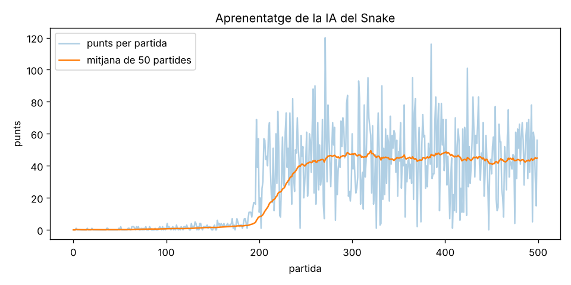

# IA que aprèn a jugar al Snake

Una xarxa neuronal que aprèn a jugar a la serp **des de zero**, sense que ningú li expliqui les regles:
només rep una recompensa quan menja (+10) i un càstig quan mor (−10). Fa servir
**aprenentatge per reforç** amb l'algorisme **DQN (Deep Q-Network)**.



En 500 partides (≈9 minuts en un portàtil) passa de 0 punts a una **mitjana de ~90 punts** (rècord 125)
en un tauler de 20×20. Durant l'entrenament la mitjana és més baixa (~45) perquè l'1 % de les jugades
encara són a l'atzar per explorar, i amb una serp llarga una sola jugada dolenta és mortal.

## Versions

| Versió | Què veu la serp | Mitjana | Màxim |
|---|---|---|---|
| 1 | Només les caselles del costat del cap (11 valors) | 30,7 | 53 |
| **2 (actual)** | També **on té el cos**: espai lliure, camí a la cua i distància a l'obstacle (20 valors) | **89,5** | **125** |

*Avaluat en les mateixes 100 partides (llavors 1000–1099) per a les dues versions.*

### Com sap on té el cos (versió 2)

Per a cada moviment possible (recte, dreta, esquerra) la serp calcula, abans de moure's:

- **Espai lliure** — quantes caselles podria recórrer si va cap allà (*flood fill*). Si girar la porta a una bossa petita tancada pel seu cos, el valor és gairebé 0.
- **Camí a la cua** — si des d'allà pot arribar a la cua. La cua es va movent, així que seguir-la és una sortida que mai es tanca.
- **Distància a l'obstacle** — quantes caselles pot avançar en línia recta abans de xocar.

## Com funciona

| Peça | Fitxer | Què fa |
|---|---|---|
| Joc | `game.py` | El Snake, sense gràfics, perquè vagi molt ràpid. Accions: recte, dreta, esquerra. |
| Estat | `agent.py` → `get_state` | Resumeix la situació en 20 valors: perill recte/dreta/esquerra, direcció actual, cap a on és el menjar i **on té el cos** (vegeu més avall). |
| Cervell | `agent.py` → `QNet` | Xarxa neuronal 20 → 256 → 256 → 3 que estima el **valor Q** (punts futurs esperats) de cada acció. |
| Aprenentatge | `agent.py` → `train_step` | Equació de Bellman: `Q(s,a) ≈ recompensa + 0.95 · Q(s', millor acció)`, amb *target network* i *Double DQN* perquè sigui estable. |
| Exploració | `train.py` | Al principi juga a l'atzar (ε = 100 %) i va confiant cada cop més en la xarxa (ε → 1 %). |
| Memòria | `agent.py` → `memory` | Guarda experiències i en repassa lots a l'atzar (*experience replay*). |

## Executar-ho

```bash
git clone https://github.com/jofreriusborrut-oss/snakeAI.git
cd snakeAI
pip install -r requirements.txt

python train.py                  # entrena (500 partides); desa model/snake_dqn.pt i model/training.png
python play.py                   # mira-la jugar en una finestra (pygame)
python play.py --text            # o al terminal
python play.py --games 50 --fast # avalua: mitjana i màxim de 50 partides
python play.py --segur           # amb el guardià: guanya TOTES les partides
python test_game.py              # proves del joc
```

Ja hi ha un model entrenat a `model/snake_dqn.pt`, així que pots executar `play.py` directament.

## Mode guanyador: el guardià (`--segur`)

Una xarxa neuronal sola no pot garantir que guanyi sempre: s'equivoca de tant en tant, i amb una serp
llarga un sol error és mortal. Per això hi ha un **guardià** (`guardian.py`) basat en un
**cicle hamiltonià**: un camí que passa per totes les caselles del tauler i torna a l'inici.
Seguint aquest camí la serp no pot xocar mai.

La IA continua decidint, però el guardià només accepta les seves jugades si són **dreceres segures**:

1. no avancen tant pel cicle que passin per davant de la cua, i
2. no salten per sobre del menjar (així sempre hi acaba arribant).

Si cap jugada de la IA és segura, la serp segueix el cicle. Amb aquestes regles està demostrat
que la serp **omple tot el tauler (397 punts) a totes les partides**. Les proves (`test_game.py`)
ho comproven fins i tot amb una "IA" que tria a l'atzar.

## Límits i idees per millorar

Sense el guardià, quan és molt llarga (més de ~100 caselles) encara queda atrapada, perquè no planifica
diversos moviments endavant. Amb el guardià guanya sempre, però triga unes 35.000 jugades a omplir el tauler.
Possibles millores:

1. Que vegi **tot el tauler** com una imatge i fer servir una xarxa convolucional (CNN).
2. Entrenar-la més partides o en taulers més petits primer (*curriculum learning*).
3. Provar altres algorismes: PPO, A2C (per exemple amb `stable-baselines3`).
4. Combinar la xarxa amb una cerca de pocs moviments endavant, com fa AlphaZero.
5. Entrenar la IA *amb* el guardià activat, perquè aprengui a triar les dreceres que fan guanyar més ràpid.
